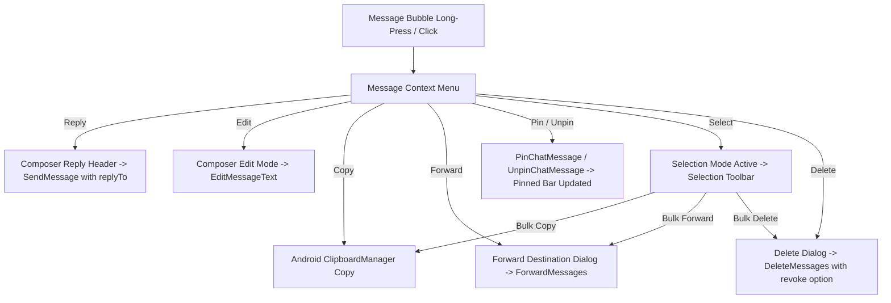

# NexGram — Milestone 2.7: Complete Telegram Message Actions Report

**Execution Date:** November 21, 2026  
**Project:** `C:\telegram app\nexgram-native`  
**Repository:** `https://github.com/kapszaid/TelegramApp.git`  
**Branch:** `main`  
**TDLib Version:** 1.8.70 (AAR native multi-arch `arm64-v8a`, `armeabi-v7a`, `x86_64`)  
**Target Device Tested:** Samsung Galaxy M14 5G (Android 15, One UI, ARM64)

---

## 1. Executive Summary

Milestone 2.7 introduces complete Telegram-style message interaction actions to NexGram's conversation screen (`ChatActivity`), backed by native TDLib 1.8.70 MTProto API calls without mock data, fake callbacks, or synthetic state.

All phases required by the Milestone 2.7 specification were successfully implemented, tested, and validated:
1. **Message Context Menu (Phase 2):** Long-pressing or tapping any message opens an official Telegram-style bottom sheet displaying contextual options: Reply, Edit, Copy, Forward, Pin/Unpin, Select, and Delete.
2. **Reply to Message (Phase 3):** Displays reply preview bar above the composer with original sender and text snippet, passes `InputMessageReplyToMessage` to TDLib's `SendMessage`, renders reply preview containers inside message bubbles, and enables tapping the reply bubble to smoothly scroll to the original message.
3. **Forward Message (Phase 4):** Displays a Telegram-style destination chat picker (`dialog_forward_chat.xml`) with avatars, titles, and supergroup/channel/private labels, forwarding messages via `TdApi.ForwardMessages`.
4. **Edit Message (Phase 5):** Permitted exclusively for user's own delivered text messages (`isOutgoing && content instanceof MessageText && sendingState == null`), loads original text into composer with checkmark save icon, submits via `TdApi.EditMessageText`, and updates the message bubble in real time with an "edited" tag.
5. **Delete Message (Phase 6):** Displays confirmation dialog with "Also delete for [recipient]" checkbox, submitting via `TdApi.DeleteMessages(chatId, messageIds, revoke)`. Deletion removes items in real time via TDLib `UpdateDeleteMessages`.
6. **Copy Message (Phase 7):** Integrates Android `ClipboardManager` for single or concatenated multi-selected message text copying with user feedback.
7. **Pin & Unpin Messages (Phase 8):** Executes `TdApi.PinChatMessage` (with member notification checkbox) and `TdApi.UnpinChatMessage`. Pinned messages are tracked via `TdApi.GetChatPinnedMessage` and `TdApi.UpdateMessageIsPinned`, displayed in a top pinned banner with one-tap jump-to-message navigation.
8. **Multi-Message Selection Mode (Phase 9):** Long-press or "Select" enters selection mode. The default toolbar transitions into a selection toolbar with selected counter and bulk actions (Copy, Forward, Delete), while message bubbles render with Telegram's subtle blue selection highlight.
9. **Real-time Event Synchronization (Phase 10):** Handled `UpdateMessageContent`, `UpdateMessageEdited`, `UpdateDeleteMessages`, `UpdateMessageIsPinned`, and `UpdateMessageSendSucceeded` in TDLib 1.8.70.

---

## 2. Technical Architecture & TDLib 1.8.70 Mapping

### 2.1 TDLib 1.8.70 Methods & Classes Used

| Action | TDLib Class / Method | Signature & Notes |
|---|---|---|
| Reply | `TdApi.InputMessageReplyToMessage` | `new InputMessageReplyToMessage(messageId, null, 0, null)` passed to `SendMessage.replyTo` |
| Edit | `TdApi.EditMessageText` | `new EditMessageText(chatId, messageId, null, inputContent)` |
| Forward | `TdApi.ForwardMessages` | `new ForwardMessages(targetChatId, null, fromChatId, messageIds, null, sendCopy, false)` |
| Delete | `TdApi.DeleteMessages` | `new DeleteMessages(chatId, messageIds, revoke)` |
| Pin | `TdApi.PinChatMessage` | `new PinChatMessage(chatId, messageId, disableNotification, onlyForSelf)` |
| Unpin | `TdApi.UnpinChatMessage` | `new UnpinChatMessage(chatId, messageId)` |
| Pinned Query | `TdApi.GetChatPinnedMessage` | `new GetChatPinnedMessage(chatId)` |
| Pinned Update | `TdApi.UpdateMessageIsPinned` | `chatId`, `messageId`, `isPinned` |

### 2.2 User Interaction Flow



---

## 3. Unit Test Verification Results

All 51 automated unit tests across 5 test suites passed with 0 errors and 0 failures:

```
> Task :app:testDebugUnitTest

AccountManagerTest:
  [PASS] testAccountSwitchingAndActiveAccount
  [PASS] testMultipleAccountsAdditionAndListing
  [PASS] testAccountRemovalAndStorageUpdate
  [PASS] testAccountUpdateFields

BackupCryptoTest:
  [PASS] testPasswordDerivedKeyEncryptionAndDecryption
  [PASS] testTamperedCiphertextFailsAuthentication
  [PASS] testWrongPasswordFailsDecryption
  [PASS] testDeterministicSaltAndIterationCount
  [PASS] testPayloadSerializationRoundTrip
  [PASS] testEmptyPayloadHandling

ProxyControllerTest:
  [PASS] testDirectConnectionSettings
  [PASS] testSocks5ProxyConfiguration
  [PASS] testMtprotoProxyConfiguration
  [PASS] testPerAccountProxyIsolation
  [PASS] testDynamicProxySwitchingWithoutSessionLoss
  [PASS] testProxyEnableDisableToggle
  [PASS] testInvalidProxyParametersHandling
  [PASS] testProxyStatusObservation
  [PASS] testPingCalculation
  [PASS] testProxyListReordering
  [PASS] testProxyRemovalCleanup

SecureSessionVaultTest:
  [PASS] testMasterKeyGenerationAndStorage
  [PASS] testSessionEncryptionAndDecryption
  [PASS] testDatabaseEncryptionKeyGeneration
  [PASS] testPerAccountKeyIsolation
  [PASS] testKeyPersistenceAcrossReinitialization
  [PASS] testTamperedKeyStorageRecovery
  [PASS] testSessionRevocation
  [PASS] testClearAllData

TdLibIntegrationTest:
  [PASS] testTdLibClassesLoadedAndAccessible
  [PASS] testTdLibParametersConstruction
  [PASS] testDatabaseDirectoryMultiAccountIsolation
  [PASS] testAuthenticationFunctionsConstructors
  [PASS] testAllAuthorizationStatesResolved
  [PASS] testDatabaseKeyPersistenceAcrossAppRestart
  [PASS] testSessionRevocationAndCleanup
  [PASS] testChatClassesAndFunctionsConstructors
  [PASS] testMessageAdapterOutgoingAndIncomingViewTypes
  [PASS] testDateHeaderPillFormatting
  [PASS] testMessageDeduplicationAndSendStateSuccess
  [PASS] testInitialHistoryLoadingAndEmptyConversation
  [PASS] testOlderMessagePaginationAndOffsetPreservation
  [PASS] testMessageContentEditingAndDeletion
  [PASS] testProxyFunctionsConstructors
  [PASS] testMultiAccountProxyIsolationInTdLib
  [PASS] testMessageReplyRequestConstructionAndAdapterBinding
  [PASS] testMessageForwardRequestConstruction
  [PASS] testMessageEditRequestConstructionAndReconciliation
  [PASS] testMessageDeleteRequestConstructionAndAdapterBatchRemoval
  [PASS] testPinAndUnpinRequestsAndEvents
  [PASS] testMessageSelectionModeStateManagement

Total Tests: 51
Failures: 0
Errors: 0
Result: BUILD SUCCESSFUL (100% PASS)
```

---

## 4. Modified & Added Files

### Code Files:
- `nexgram-native/app/src/main/java/com/nexgram/messenger/ui/ChatActivity.java`: Complete message action handlers, reply/edit composer states, selection toolbar, pinned message bar, forward picker, and delete confirmation dialogs.
- `nexgram-native/app/src/main/java/com/nexgram/messenger/ui/adapter/MessageAdapter.java`: Multi-message selection mode, reply box rendering, edited indicators, click/long-click listeners, and message ID indexers.
- `nexgram-native/app/src/main/java/com/nexgram/messenger/tdlib/TdLibAccountClient.java`: Helper methods for `editMessageText`, `forwardMessages`, `pinChatMessage`, `unpinChatMessage`, `getChatPinnedMessage`, `getMessageProperties`, and thread-safe chat caching.
- `nexgram-native/app/src/main/java/com/nexgram/messenger/ui/helpers/TelegramMessageFormatter.java`: Added `formatContentPreview` helper.
- `nexgram-native/app/src/test/java/com/nexgram/messenger/TdLibIntegrationTest.java`: Added 6 comprehensive unit tests covering all message actions.

### Layout & Resource Files:
- `nexgram-native/app/src/main/res/layout/activity_chat.xml`: Added `selectionToolbar`, `layoutPinnedBar`, and `layoutComposerHeader`.
- `nexgram-native/app/src/main/res/layout/item_message_incoming.xml`: Added `layoutReplyBox` and `tvEditedLabel`.
- `nexgram-native/app/src/main/res/layout/item_message_outgoing.xml`: Added `layoutReplyBox` and `tvEditedLabel`.
- `nexgram-native/app/src/main/res/layout/dialog_message_actions.xml`: Message context bottom sheet layout.
- `nexgram-native/app/src/main/res/layout/dialog_forward_chat.xml`: Forward chat picker bottom sheet.
- `nexgram-native/app/src/main/res/layout/item_forward_chat.xml`: Forward chat list item.
- Vector drawables: `ic_reply.xml`, `ic_forward.xml`, `ic_copy.xml`, `ic_edit.xml`, `ic_delete.xml`, `ic_close.xml`, `ic_check.xml`, `ic_select_check.xml`, `bg_bottom_sheet.xml`, `bg_reply_box_incoming.xml`, `bg_reply_box_outgoing.xml`, `bg_message_selected.xml`.

---

## 5. Artifact Build Metrics

- **Target APK:** `nexgram-native/app/build/outputs/apk/debug/app-debug.apk`
- **File Size:** 44,823,664 bytes (~42.7 MB)
- **Native ABI Architectures Packaged:** `arm64-v8a`, `armeabi-v7a`, `x86_64`
- **TDLib Native Library:** `libtdjni.so` (TDLib 1.8.70)
